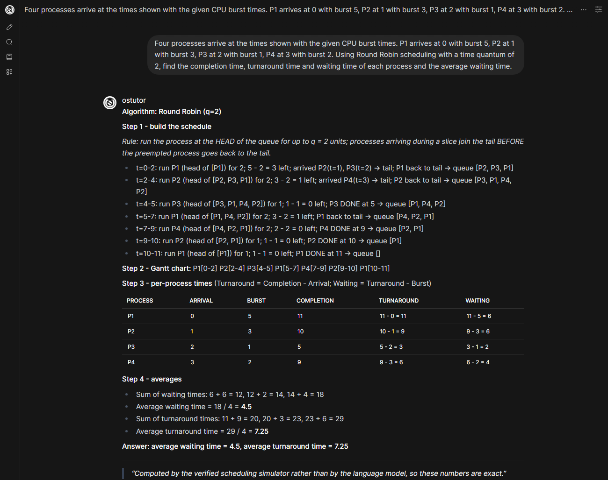
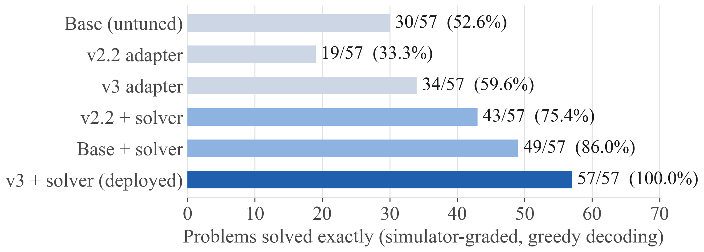
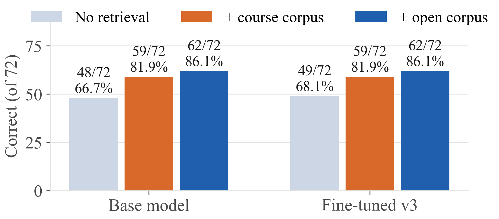
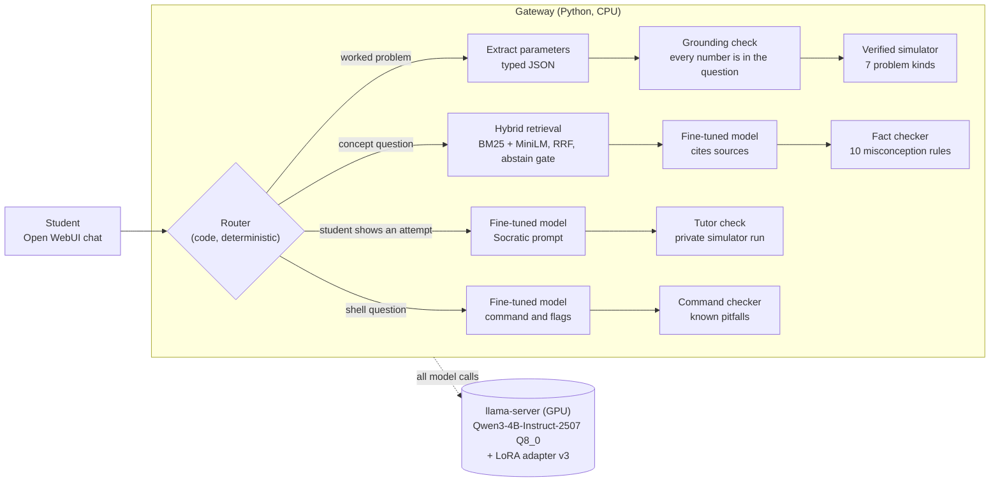

<div align="center">


# OS Tutor

**A fine-tuned, retrieval-grounded and simulator-verified tutor for Operating Systems.**
**The model explains. Verified simulators compute. Code checks every reply before a student sees it.**

[](https://github.com/Divyakush2006/OS-Tutor/actions/workflows/ci.yml)
[](LICENSE)
[](requirements.txt)
[](https://huggingface.co/Qwen/Qwen3-4B-Instruct-2507)
[](#run-the-full-stack)
[](docs/OS-Tutor-Final-Report.pdf)

[Results](#results) · [How it works](#how-it-works) · [Quick start](#quick-start) · [Reproduce](#reproduce-the-results) · [Limitations](#limitations) · [Report (PDF)](docs/OS-Tutor-Final-Report.pdf)

</div>

---

## Why this exists

Operating Systems has two layers. The **conceptual** layer is why virtual memory exists and what a context switch costs. The **procedural** layer is the part students carry out by hand: CPU schedules, page-replacement traces, Banker's-algorithm tables, disk-head movement. One misplaced process in a Round Robin queue changes every number that follows.

General-purpose language models are good at the first layer. At the second they fail in a characteristic way: they **state the rule correctly and then execute it wrongly**. On our 57-problem suite, *every one* of the fine-tuned model's 7 scheduling failures had correct arithmetic on a wrong schedule. Scheduling had the most training rows of any family (1,733) and still the worst accuracy (42%), so more data was not the fix.

OS Tutor is built around that measurement. A small model is reliable at **reading** a problem and **explaining** a rule, and unreliable at **executing** a long procedure. So the model explains and verified simulators compute, and every other known failure mode is assigned to a component that cannot make that mistake. The whole system runs privately on one laptop GPU.

<div align="center">

<br>
<sub><b>A real answer from the running system.</b> The router sent the problem to Solve, and the scheduling simulator produced every step, including the queue rule the model alone gets wrong. The averages are exact.</sub>
</div>

## Results

Every claim is measured with paired, significance-tested evaluations (exact McNemar test, deterministic greedy decoding). Full detail is in the [final report](docs/OS-Tutor-Final-Report.pdf).

| Measure | Result | Evidence |
|---|---:|---|
| Hand-written OS problems solved exactly | **57 / 57** | untuned base: 30 / 57 |
| Unseen problem framings (600-item holdout) | **99.8 %** | 599 / 600; all 80 disk items exact after the range fix |
| Short-answer accuracy with retrieval | **86.1 %** | 68.1 % without; **p = 0.007** |
| Invented citations in grounded answers | **0** | 69 / 72 answers cite a source |
| Tutor replies that keep the answer back | **30 / 30** | 15 / 30 before the private simulator check |
| General-knowledge forgetting after fine-tuning | **none detectable** | MMLU 80.25 % → 79.50 %, p = 0.68 |
| Retrieval latency (95th percentile, CPU) | **9.2 – 21.2 ms** | budget 500 ms |
| Decode speed on an 8 GB laptop GPU | **42.9 tok/s** | target ≥ 20 tok/s |
| Automated checks | **355** | five suites, all passing (351 on a clean clone, see [Quick start](#quick-start)) |

### What each layer contributes

Six configurations, measured on the served path over the same 57 problems. The solver is the main lever (+23 problems, **zero** lost, p < 10⁻⁶); the fine-tune alone is not significant (30 → 34, p = 0.557), which is why the system is a tool-using tutor rather than a bigger fine-tune.

<div align="center">

</div>

### Retrieval makes answers checkable

Hybrid retrieval over a 2,970-document openly licensed corpus lifts the fine-tuned model's short-answer accuracy by **+18 points** (p = 0.007) and never cites a source that does not exist.

<div align="center">

</div>

### Faults found in end-to-end testing, each fixed and re-measured

| Fault | Root cause | Result after the fix |
|---|---|---|
| Tutor revealed a (wrong) count | Tutor mode was isolated from the solver, so nothing checked its reply | answer kept back **30 / 30** (was 15 / 30); correct students confirmed **6 / 6** (was 0 / 6) |
| Disk size misread from "0–299" | The grounding check passes 299 because 299 appears in the question | disk items **80 / 80** (was 74 / 80), none lost |
| Fact-checker false alarms and a miss | Negation searched sentence-wide; question headings read as claims | precision **2 / 2**, recall **2 / 2**; 0 flags on 70 broader answers |
| Shell command sorted sizes as text | Commands were model-generated and unchecked | corrected to `sort -k 5 -rh` and explained |
| Off-topic question answered | The classifier's verdict only added a note | everyday questions declined **17 / 20**; OS questions answered **267 / 268** |

## How it works



| Layer | What it does | Guards against |
|---|---|---|
| **Router** | Code, not a prompted model. A shown attempt always goes to tutor mode. 28 labelled cases, zero misroutes allowed. | Handing a student the answer when they need to think |
| **Parameter extraction + grounding** | The model reads a problem into typed JSON; every number must appear in the question. A missing input is asked for, never guessed. | Invented inputs (it once invented a Banker's `Available` vector) |
| **Verified simulators** | Seven kinds: CPU scheduling (7 algorithms), page replacement, disk scheduling, Banker's safety and request, free-space allocation, address translation. Unit-tested against canonical textbook answers. | Executing a correct rule wrongly |
| **Hybrid retrieval** | BM25 + MiniLM fused by reciprocal rank, with an abstain gate fitted on held-out data and `[S1]`-style citations. | Unverifiable explanations; "least-bad" passages cited as support |
| **Fact checker** | Screens prose against ten known misconceptions and redrafts with the correct fact. | Confidently repeated textbook errors |
| **Tutor check** | A private simulator run judges the student's attempt. A reply that states the answer, asserts a result the student did not write, or works the problem step by step is redrafted, then replaced by a fixed hint. | Answer leakage |
| **Command checker** | Fixes or cautions on known shell pitfalls (`sort -h`, unquoted `find -name`, `rm -rf /`, `chmod 777`). | Subtly wrong commands |
| **Scope guard** | A question that is not about operating systems is declined without calling the model. | Off-topic answers |

### Teaching modes

| Mode | Purpose | Output |
|---|---|---|
| `ostutor` (auto) | Reads the question and picks the mode | whichever mode applies |
| `ostutor-solve` | Worked numerical problems | numbered, auditable steps; final answer last |
| `ostutor-explain` | Concepts and definitions | explanation with an example and citations |
| `ostutor-analyze` | Trade-offs and design | givens, mechanisms, trade-offs, recommendation |
| `ostutor-tutor` | Student shows an attempt | diagnosis and one leading question |
| `ostutor-shell` | Linux commands | command, then each flag explained |

### Data and training

| | |
|---|---|
| **Dataset** `ostutor-sft` v3.0.0 | 11,760 training rows, built by an eleven-stage pipeline (ingest, clean, deduplicate, decontaminate, score, mix, render, split, verify) with **19 release gates that fail the build**. Evaluation items are decontaminated by problem parameters as well as by n-grams. |
| **Mixture** | Procedural 7,526 · replay 1,884 · tutoring 938 · shell 707 · conceptual 705 |
| **Fine-tune** | QLoRA via Unsloth, r = 32, α = 64 on all linear layers, one epoch (735 steps, about 3.5 h on Kaggle's free 2 × Tesla T4) |
| **Anti-forgetting** | 16 % surprise-ranked general-instruction replay, spaced through training |
| **Serving** | llama.cpp (Q8_0 base + LoRA applied at runtime), FastAPI gateway, Open WebUI front end |

## Quick start

### Run the test suites (any OS, CPU only, no model server)

```bash
git clone https://github.com/Divyakush2006/OS-Tutor.git
cd OS-Tutor
python -m venv .venv && source .venv/bin/activate       # Windows: .venv\Scripts\activate
pip install -r requirements.txt

python tools/test_pipeline.py    # 124 checks (122 on a clean clone): simulators, cleaning, dedup, gates
python tools/test_rag.py         #  69 checks (67 on a clean clone): manifests, chunking, retrieval, gate
python tools/test_g0.py          #  58 checks: statistics, extraction scoring, grader regressions
python tools/test_router.py      #  28 labelled routing cases, zero misroutes allowed
python serve/test_gateway.py     #  76 checks: layers, tutor check, command check, scope, fact checker
```

A clean clone runs **351 of the 355 checks**; the other four need inputs that are deliberately not published (the procedural pool under `data/raw`, and the course documents) and skip with a message. The first retrieval test downloads `all-MiniLM-L6-v2` (about 90 MB). The same five suites run in CI on every push.

### Run the full stack

This part needs an NVIDIA GPU with 8 GB (the stack uses about 6.5 GB), Windows 10/11 and Python 3.11 for Open WebUI. The model weights are **not** in this repository (the fine-tuned adapter is 138 MB, over GitHub's file limit); the base model is public on Hugging Face and the adapter is reproduced by the training script below.

1. Follow [`serve/README.md`](serve/README.md) for the one-time setup: llama.cpp build b11050, the Qwen3-4B-Instruct-2507 GGUF, the LoRA converted to GGUF, and Open WebUI.
2. Choose a retrieval corpus (optional, unset means no retrieval) and start everything:

```powershell
$env:OSTUTOR_RAG = "data/rag/open"
powershell -ExecutionPolicy Bypass -File serve\start_tutor.ps1     # opens http://localhost:3000
powershell -ExecutionPolicy Bypass -File serve\stop_tutor.ps1      # frees the GPU
```

`start_tutor.ps1` starts the model server (`:8081`), the gateway (`:8090`) and the chat UI (`:3000`), applies the project branding from [`assets/logo.jpg`](assets/logo.jpg), and refuses to start if another job holds the GPU. Everything runs on `127.0.0.1`: no student question leaves the machine.

## Reproduce the results

| Command | Purpose | Needs |
|---|---|---|
| `python -m ostutor.build` | Build the dataset (11 stages, 19 release gates) | raw sources under `data/raw` (see [`DATASET_CARD.md`](DATASET_CARD.md) for sources, licences and hashes) |
| `python train/kaggle_train.py` | QLoRA fine-tune on Kaggle (2 × T4) | the `ostutor-sft` dataset uploaded to Kaggle ([`tools/kaggle_launch.py`](tools/kaggle_launch.py)) |
| `python tools/g0_ablation.py` | 57-item suite, 600-item holdout, fact checker | GPU, model server |
| `python tools/rag_eval.py data/rag/corpus --calibrate` | Retrieval quality and abstain gate | retrieval corpus |
| `python tools/rag_e2e.py data/rag/open` | End-to-end retrieval evaluation | GPU, model server |
| `python tools/final_review_eval.py` | Before and after measurements of the testing fixes | GPU, model server |
| `python docs/final_report/build.py` | Rebuild the final report PDF | `requirements-report.txt`, Microsoft Edge |

Every run records its commit, model hashes, server arguments and decoding settings under [`reports/`](reports/), and every number in the report names the result file it comes from. Scientific choices are logged with alternatives and evidence in [`docs/DECISIONS.md`](docs/DECISIONS.md).

## Repository layout

```text
ostutor/            data pipeline and verified solver
  simulators/       scheduling, memory, Banker's, formulas, dialogues
  rag/              extraction, chunking, hybrid retrieval, abstain gate, citations
  evaluation/       simulator-exact grader, paired statistics
serve/              gateway (routing and checks), launch scripts, Open WebUI branding, tests
tools/              evaluation, benchmarking, generation, packaging, and four of the test suites
train/              QLoRA training script (Kaggle)
data/               evaluation suites, retrieval manifests and labelled question sets
reports/            measured results, one folder per run, with provenance
docs/               final report (PDF + source), decision log, design documents, RAG corpus guide
assets/             logo and screenshots
```

## Data, licences and what is not included

- **Code and documentation** are released under the [MIT License](LICENSE).
- **Training data** is commercially licensed row by row (MIT 8,991 · ODC-BY-1.0 959 · mixed-permissive 925 · CC-BY-4.0 885). Sources that could not be used were excluded and are listed in [`DATASET_CARD.md`](DATASET_CARD.md).
- **Open retrieval corpus** (2,970 documents, 18,515 chunks) is rebuilt from openly licensed text (Hailperin, Wienand, Wikipedia, a Wikibook, Stack Exchange). The committed manifest records source, licence and SHA-256 for every document, and ingestion refuses a corpus that drifts from it.
- **Not included:** the course lecture material used for the course corpus (it belongs to the course and is not redistributed; only its checksums are recorded), the model weights, and raw dataset sources. Retrieval outputs that quoted course slides have their passage text withheld.
- **Chat interface:** [Open WebUI](https://github.com/open-webui/open-webui) is installed from PyPI and rebranded locally by `serve/branding.py`, which its licence permits for deployments with at most 50 end users in 30 days. Larger deployments should keep the original branding.

## Limitations

Stated plainly, because they bound what the results mean.

- **Seven problem kinds are computed by simulators.** Formula questions (effective access time, page-table bits, fork counts) are answered by the model, and Solve mode labels them "not computed by a simulator".
- **The evaluation sets are in-house.** The retrieval, short-answer, tutor-attempt and new MCQ items were written by the project, with AI assistance, and have not been reviewed by an instructor. They may be easier than student-written questions.
- **Citations are real but not always fully supported.** On a strict manual reading, 60 to 66 % of cited claims are supported in full by their passage; the rest mostly add the model's own elaboration. Sources are listed under every answer so a student can check them.
- **The checks cover known cases.** The fact checker covers ten misconceptions, the command checker known shell pitfalls, and the tutor check compares numbers for scheduling, paging, disk and address-translation problems (and blocks step-by-step working for every kind). Errors outside these lists are not caught.
- **Tutor hint wording still comes from the model.** The check guarantees a hint does not give the answer away. In 24 hints read by hand, 19 were accurate and 2 contained a factual error.
- **No classroom study.** Everything measured concerns the tutor's answers, not whether students learn more.
- **One request at a time** on an 8 GB laptop GPU; concurrent class-scale use was not load-tested.

## Documentation

| Document | What is in it |
|---|---|
| [Final report (PDF)](docs/OS-Tutor-Final-Report.pdf) | Literature review, methodology, every result and the faults found in testing |
| [`docs/DECISIONS.md`](docs/DECISIONS.md) | Decision log: each significant choice, its alternatives and its evidence |
| [`DATASET_CARD.md`](DATASET_CARD.md) | Dataset composition, licences, hashes and release gates |
| [`docs/RAG_CORPUS.md`](docs/RAG_CORPUS.md) | How the retrieval corpora are built and checked |
| [`serve/README.md`](serve/README.md) | The serving stack, its settings and why |
| [`reports/final_review/`](reports/final_review) | Before and after measurements for the five fixes |

## Authors

Built for **BCSE303L – Operating Systems** at the School of Computer Science and Engineering (SCOPE), Vellore Institute of Technology.

**Divyakush Punjabi** ([@Divyakush2006](https://github.com/Divyakush2006)), author and maintainer.

## Citation

```bibtex
@software{ostutor2026,
  title   = {OS Tutor: A Fine-Tuned, Retrieval-Grounded and Simulator-Verified Tutor for Operating Systems},
  author  = {Punjabi, Divyakush},
  year    = {2026},
  version = {3.0.0},
  url     = {https://github.com/Divyakush2006/OS-Tutor}
}
```

GitHub's **Cite this repository** button reads [`CITATION.cff`](CITATION.cff).

## Acknowledgements

Built on [Qwen3](https://arxiv.org/abs/2505.09388), [llama.cpp](https://github.com/ggml-org/llama.cpp), [Unsloth](https://github.com/unslothai/unsloth), [Open WebUI](https://github.com/open-webui/open-webui) and [sentence-transformers](https://www.sbert.net/). The design draws on retrieval-augmented generation (Lewis et al., 2020), QLoRA (Dettmers et al., 2023), "LoRA Learns Less and Forgets Less" (Biderman et al., 2024), program-aided language models (Gao et al., 2023) and the CS50 AI tutor (Liu et al., 2024); the full reference list is in the [report](docs/OS-Tutor-Final-Report.pdf).

<div align="center">
<sub>The model explains. The simulators compute. The code checks.</sub>
</div>
